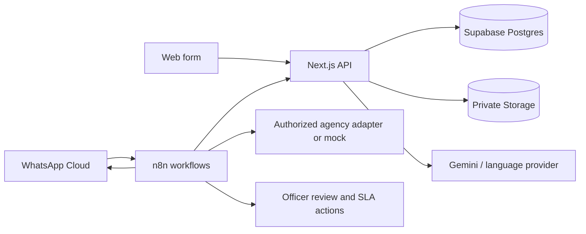

# CivicPilot implementation plan and product specification

## Product goal

Help a resident report a local, non-emergency civic issue through the web or WhatsApp, then follow that issue through a department response and citizen-confirmed resolution. n8n is the visible workflow control plane; the Next.js service owns validation, durable records, private media, and public read views.

## Pilot boundary

- Pilot Bengaluru, Karnataka, for three categories: roads, sanitation, and street lighting. These are internal pilot queues, not verified government assignments. Other categories remain review-only until a ward/corporation and agency map is approved.
- Support English, Hindi, and Kannada in the pilot. The original message is retained; translation is a working copy and never overwrites the citizen's words.
- Accept photo, text, and location on web and WhatsApp. Voice intake follows once a speech provider and test corpus are available.
- A government connector is an adapter and a mock until the specific agency grants access. A CivicPilot ticket is never represented as an official government ticket without an official ID.
- Emergency reports are shown an emergency-service instruction and sent for human review; the system does not claim to dispatch emergency responders.

The [Greater Bengaluru Authority portal](https://bbmp.gov.in/) lists five Bengaluru city corporations, and its [published corporation maps](https://www.bbmp.gov.in/maps/) provide a starting point for jurisdiction validation. The [Fix My Street overview](https://site.bbmp.gov.in/departmentwebsites/BBMPIT/fms.html) shows that pothole, garbage, and streetlight reporting already exists. CivicPilot's proposed value is multilingual WhatsApp clarification, transparent human review, incident grouping, and citizen-confirmed closure; it must be tested against these existing services rather than described as a first-of-its-kind city reporting app.

## User journeys and acceptance criteria

| Journey | Acceptance criterion |
| --- | --- |
| Web report | Citizen can upload a JPEG, PNG, or WebP image up to 5 MB, describe the issue, supply a landmark or pin, and receive a stable ticket ID. The image is stored in a private bucket. |
| WhatsApp report | Incoming Meta message reaches n8n, which calls a secured internal endpoint. A photo and text can be submitted directly. Missing description or location creates a durable clarification state and a reply in the citizen's language. Message ID is the idempotency key. |
| Triage | AI returns structured category, severity, confidence, and explanation. Low-confidence/unsafe results enter review; the officer can override them. No missing location is fabricated. |
| Incident grouping | Same-category, same-place reports inside the active window are linked to a canonical incident. Different locations stay separate. Each resident keeps an individual ticket. |
| Resolution | Officer records notes and optional evidence, then status becomes resolved. Citizen confirms or reopens. Closure is labelled citizen-confirmed only after explicit positive feedback. |
| Government sync | A connector records an official reference and sync result only after authorization. Mock mode is visibly labelled. Sync errors stay retryable and never silently imply success. |

## Core architecture

### Key records

- `complaints`: individual reports, canonical link, status, language, source, photo reference, resolution evidence, official reference fields. The current pilot does not automatically identify a Bengaluru ward or city corporation.
- `complaint_events`: append-only audit trail with redacted public projection.
- `conversation_drafts`: one pending WhatsApp report per sender, with stage, received data, and expiry.
- `notifications`: delivery attempts and outcomes. A simulated attempt is never shown as delivered.
- Private `civic-evidence` storage bucket: original and resolution photos; no anonymous read policy.

### API contracts

- `POST /api/media`: multipart `file`; returns an opaque `evidence://...` reference. Internal callers authenticate with `x-webhook-secret`; public intake is rate-limited.
- `POST /api/intake`: existing web JSON contract, including `image_url` set to the returned evidence reference.
- `POST /api/internal/whatsapp-intake`: authenticated JSON `{message_id, from, text?, image_media_id?, location?, language?}`; returns `{action: "reply", text, ticket_number?}`. The server downloads Meta media while its URL is valid and persists a clarification draft if fields are missing.
- `GET /api/complaints/:id`: public redacted ticket and timeline. Staff-only fields require staff authentication.
- `POST /api/feedback`: ticket-scoped private capability or authenticated workflow; returns the new ticket state.

## Delivery order

1. **Foundation:** schema, private media upload, actual web file input, removal of fake GPS fallback, and secure public ticket projection.
2. **WhatsApp journey:** authenticated intake endpoint, durable clarification draft, image download, n8n trigger and reply workflow, message idempotency.
3. **Language journey:** UI strings and response templates for the pilot languages; provider-backed speech/translation, original/transcript/translation and confidence; human correction path.
4. **Closed-loop resolution:** officer evidence, citizen confirmation/reopen, n8n follow-up and SLA reminders, redacted public timeline.
5. **Government adapter:** jurisdiction map, approved endpoint or Open311 connector, official reference/status sync, retry/audit; mock path for demo.
6. **Launch gate:** staff authentication, authorization on every route, persistent rate limiting, media scanning/retention, privacy notice/consent, provider credentials, workflow activation, monitoring, backup and recovery, and accessibility/mobile testing.

## Demo and evaluation

Run three cases: a Hindi WhatsApp photo with missing location that triggers a clarification; a second report at the same location that joins an incident; an ambiguous or hazardous report routed to an officer. Resolve one case, submit citizen feedback, and show confirmation or reopening. Capture actual workflow executions. Measure triage latency, correct routing, duplicate precision, clarification completion, review overrides, SLA breaches, and citizen-confirmed closure. Do not use invented impact numbers.

## External setup required

Live WhatsApp needs a Meta business portfolio, WhatsApp Cloud app/number, access token, and n8n credentials. BHASHINI or another language provider needs onboarding and credentials. A live municipal connector requires that agency's approval, endpoint, service categories, and test account. Supabase and n8n deployment credentials are required for a durable public launch.

## Implementation status (17 October 2026)

- Implemented: private photo storage and web upload; no fabricated GPS; English, Hindi, Kannada clarification and reply templates; WhatsApp text/photo/location intake endpoint with 24-hour drafts and message replay handling; citizen `STATUS`, `FIXED`, and `REOPEN` commands; redacted public ticket and timeline; staff-only evidence view; agency mock/Open311 adapter with explicit enablement; importable n8n intake and agency workflows. Bengaluru's three pilot categories route to internal queues; other categories require jurisdiction review.
- Partly implemented: all seven workflows are imported into local n8n 2.43.7. The intake workflow is published locally and passed synthetic direct-webhook, web submission, private photo, public redaction, and Supabase cleanup checks. Gemini 3.6 Flash classified a Kannada synthetic road report through the published webhook with 0.95 confidence and no fallback; its audit record names the model. The six other workflows still need credentials and execution checks. Provider-backed translation and vision analysis remain pending. A Meta WhatsApp test number and token are configured locally and the token was verified against the phone-number ID through Graph API; inbound webhooks, photo download, and outbound delivery still need end-to-end testing over HTTPS.
- Pending: voice transcription and voice responses, a Bengaluru city-corporation/ward map, citizen consent and retention controls, staff identity/role management, durable distributed rate limiting, agency pilot approval, deployment and monitoring. The Bengaluru Supabase project is connected: six queues, the private evidence bucket, durable ticket intake, public redaction, and cleanup were verified with synthetic records. A hosted n8n service, Meta WhatsApp, and municipal credentials are pending. The app is **not yet ready for a public launch**.

### Setup sequence for the project owner

1. Obtain current Bengaluru city-corporation and ward boundaries, then validate the owner and service channel for roads, sanitation, and street lighting with each participating agency. Until then, labels are internal queues. Confirm Kannada wording with native-speaking testers.
2. Run `supabase/SETUP_BENGALURU.sql` once in the empty Bengaluru Supabase project's SQL Editor. This bundles migrations in timestamp order and inserts only internal pilot queues. The project URL, publishable key, and server-only secret key are saved in `.env.local`; set `DEMO_MODE=false` only after schema and storage checks pass. Check that the `civic-evidence` bucket is private. Legacy anon/service-role keys remain supported if a project does not provide the newer key types.
3. Deploy Next.js behind HTTPS. Set independent `REVIEWER_SECRET_KEY`, `FEEDBACK_SECRET_KEY`, and `N8N_WEBHOOK_SECRET`; replace the shared staff key with authenticated staff accounts before inviting the public. Configure `PILOT_ESCALATION_EMAIL` only with an approved pilot-team mailbox.
4. Deploy n8n, configure `CIVICPILOT_APP_URL` and the same webhook secret, import the workflows, assign credentials, and inspect one execution per branch. Local development already uses `INTAKE_PROCESSING_MODE=n8n`; repeat the end-to-end test with the hosted n8n webhook URL before public deployment.
5. Configure a Meta WhatsApp Cloud app/number and approved outbound templates. Add `WHATSAPP_ACCESS_TOKEN`, `META_GRAPH_API_VERSION`, and `WHATSAPP_PHONE_NUMBER_ID`; test a photo plus location pin and a clarification exchange using a test number.
6. Keep `GOVERNMENT_ADAPTER=mock` until the agency supplies written approval, service codes, jurisdiction ID, HTTPS endpoint, and a test key. Then use the Open311 adapter and verify that the returned official reference appears in the staff record.
7. Add provider-backed speech/translation, privacy notice and consent, media retention/deletion, staff roles, rate limiting, monitoring, and backup/restore tests. Run the launch gate before opening public intake.
