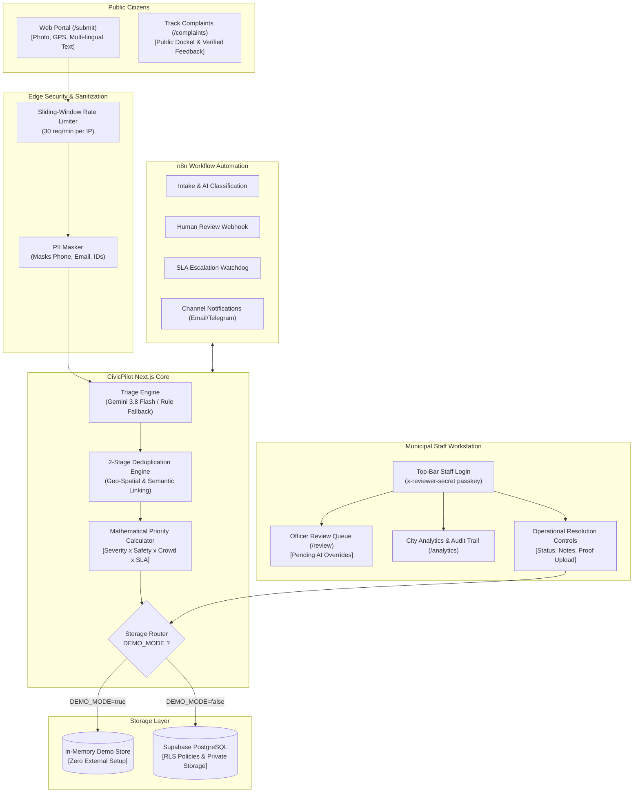

# CivicPilot 🏛️

> **Autonomous AI-Powered Civic Complaint Management & Resolution Platform**  
> *Hardened & Audited • Next.js 16 • Gemini 3.8 Flash • Supabase • n8n • Tailwind CSS*

[](https://nextjs.org/)
[](https://react.dev/)
[](https://ai.google.dev/)
[](https://supabase.com/)
[](https://n8n.io/)
[](https://www.typescriptlang.org/)
[](#-testing--quality-assurance)

**CivicPilot** transforms municipal governance from reactive, delayed ticketing into an **autonomous civic triage engine**. Built for Bengaluru's civic infrastructure needs (roads, sanitation, water supply, street lighting, and drainage), CivicPilot autonomously inspects, categorizes, prioritizes, deduplicates, and dispatches citizen grievances while maintaining transparent human-in-the-loop oversight and verified citizen closure.

---

## 🌟 Core Highlights

- **🧠 Multilingual AI Triage (Gemini 3.8 Flash)**: Ingests unstructured complaints in **English**, **Hindi (हिन्दी)**, and **Kannada (ಕನ್ನಡ)**. Sanitizes PII before inference and extracts category, subcategory, severity (1–5), confidence score, and safety flags via strict JSON schemas.
- **🛡️ Deterministic Safety Fallback**: If LLM quotas are reached or connectivity is interrupted, CivicPilot automatically falls back to an audited, deterministic rule-based heuristic classifier without downtime.
- **📍 Intelligent 2-Stage Deduplication**: Automatically clusters duplicate complaints for the same infrastructure failure within geographic radii, boosting priority rather than dispatching redundant crews.
- **⚖️ Audited Mathematical Priority Scoring**: Computes objective ticket priority using an open formula factoring in base severity, safety multipliers (1.35x for open manholes/live wires), crowd frequency boost (up to +1.00), and SLA urgency.
- **👥 Strict Citizen vs. Staff Role Differentiation**: Public citizens access an intuitive docket and filing interface without internal operational distractions. Municipal officers authenticate via a dedicated top-bar modal to unlock the Review Queue, Analytics, and Operational Controls.
- **🔄 Automated SLA Watchdog & Escalation**: Continuously evaluates resolution deadlines and idempotently escalates overdue tickets through departmental management tiers.
- **⭐ Citizen-Verified Closure**: A complaint is only marked citizen-confirmed closed once the original reporting resident explicitly validates the resolution with satisfaction feedback (1–5 stars) or reopens it if the issue persists.

---

## 👥 Citizen vs. City Staff Roles

CivicPilot enforces clear interface boundaries between public residents and municipal teams:

| Feature / Capability | Public Citizen View | City Staff / Officer View |
|---|:---:|:---:|
| **Public Dashboard (`/`)** | ✅ View public overview & metrics | ✅ View public overview & metrics |
| **Report Civic Issue (`/submit`)** | ✅ File report with photos & GPS | ✅ File report with photos & GPS |
| **Track Complaints Docket (`/complaints`)** | ✅ View public tickets & filters | ✅ View public tickets & filters |
| **Top-Bar Staff Login** | ✅ One-click login trigger button | 🔒 Replaced with Officer Pill & Sign Out |
| **Review Queue (`/review`)** | 🚫 Access restricted by `StaffGate` | ✅ Triage AI-flagged ambiguous reports |
| **Pending Review Counter Badge** | 🚫 Hidden | ✅ Real-time indicator in top bar |
| **City Analytics & Audit (`/analytics`)** | 🚫 Access restricted by `StaffGate` | ✅ Workload charts, SLA stats, audit log |
| **Staff Tools (Run SLA / Reset Demo)** | 🚫 Hidden | ✅ Dropdown menu in top bar |
| **In-Ticket Operations Controls** | 🚫 Hidden | ✅ Status update, reassign, resolution notes, photo upload |
| **Citizen Verification & Rating** | ✅ Rate resolution (1–5★) & reopen | 👁️ View citizen rating & remarks |

---

## 🏗️ System Architecture



---

## 🚀 Quick Start

### 1. Prerequisites
- **Node.js**: v18.0.0+ (Tested on Node.js 24)
- **npm**: v9.0.0+

### 2. Installation & Setup

```bash
# 1. Clone the repository
git clone https://github.com/lakshya14-ds/civicpilot.git
cd civicpilot

# 2. Install dependencies
npm install

# 3. Create your local environment configuration
cp .env.example .env.local
```

### 3. Environment Configuration (`.env.local`)

CivicPilot works out-of-the-box in zero-setup Demo Mode (`DEMO_MODE=true`). To connect with your production Supabase database, Gemini API, or n8n instance, adjust the following keys:

```env
# ==========================================
# Application Runtime Configuration
# ==========================================
DEMO_MODE=true                      # Set to 'false' to connect to live Supabase
INTAKE_PROCESSING_MODE=in_app       # 'in_app' for internal engine, 'n8n' for workflow webhooks

# ==========================================
# Municipal Staff & Administrative Passkeys
# ==========================================
REVIEWER_SECRET_KEY=dFHHbb9yr-I9bwh-hjrMxtBHwLrMaw-TrO1YGNAdbms
ADMIN_API_KEY=adm-secret-super-key-civicpilot-2026
CRON_SECRET=civicpilot-cron-watchdog-key

# ==========================================
# Google Gemini AI Integration
# ==========================================
GEMINI_API_KEY=your-gemini-api-key-here
GEMINI_MODEL=gemini-3.8-flash

# ==========================================
# Supabase PostgreSQL & Media (When DEMO_MODE=false)
# ==========================================
NEXT_PUBLIC_SUPABASE_URL=https://your-supabase-project.supabase.co
NEXT_PUBLIC_SUPABASE_PUBLISHABLE_KEY=your-supabase-publishable-key
SUPABASE_SECRET_KEY=your-supabase-service-role-key

# ==========================================
# n8n Workflow Automation (Optional)
# ==========================================
N8N_INTAKE_WEBHOOK_URL=http://localhost:5678/webhook/civicpilot-intake
N8N_WEBHOOK_SECRET=your-shared-webhook-secret
```

### 4. Running the Development Server

```bash
npm run dev
```

Open [http://localhost:3000](http://localhost:3000) in your browser:
- **As a Citizen**: File a complaint on `/submit` or track status on `/complaints`.
- **As City Staff**: Click **Staff Login** in the top navigation bar and enter `officer-1` with your configured `REVIEWER_SECRET_KEY`.

---

## 🤖 Running Local n8n Automation (Optional)

CivicPilot includes pre-configured, production-ready n8n workflows located in `n8n/workflows/`:

1. `complaint-intake.json` — Intake triage and Gemini 3.8 Flash parsing.
2. `human-review.json` — Officer review mutation and event emission.
3. `sla-escalation.json` — SLA deadline monitoring and escalation tier bumping.
4. `notifications.json` — Multi-channel citizen/officer dispatches (Email & Telegram).
5. `resolution-feedback.json` — Citizen satisfaction validation and auto-reopening.

### Starting n8n:

- **Via Local PowerShell (Windows)**:
  ```powershell
  powershell -ExecutionPolicy Bypass -File scripts\start-n8n-local.ps1
  ```
- **Via Docker Compose**:
  ```bash
  docker compose up -d n8n
  ```

Access the n8n visual editor at [http://localhost:5678](http://localhost:5678).

---

## 🔌 API Reference

### Citizen & Public Endpoints
| Method | Endpoint | Description | Access |
|---|---|---|---|
| `POST` | `/api/intake` | File a civic complaint (Rate-limited: 30 req/min) | Public |
| `GET` | `/api/complaints` | Public docket list with status & category filters | Public |
| `GET` | `/api/complaints/:id` | Full complaint details & public audit timeline | Public |
| `POST` | `/api/feedback` | Submit citizen satisfaction rating (1–5★) or reopen issue | Citizen / Token |
| `GET` | `/api/departments` | Active municipal department list | Public |

### Municipal Staff Endpoints
| Method | Endpoint | Description | Access |
|---|---|---|---|
| `POST` | `/api/auth/staff` | Authenticate officer ID & passkey (Rate-limited) | Public / Staff |
| `POST` | `/api/review` | Submit officer review action (approve / modify / reject) | Staff Key |
| `PATCH` | `/api/complaints/:id` | Update status, reassign department, add repair notes | Staff Key |
| `GET` | `/api/analytics` | Workload analytics, SLA metrics & throughput trends | Staff Key |
| `GET` | `/api/audit` | Append-only system audit log | Staff Key |
| `POST` | `/api/escalate` | Trigger SLA breach scan and department escalations | Staff / Cron |
| `POST` | `/api/seed` | Reset demo data to baseline sample reports | Admin Key |

### Internal Webhook Endpoints
| Method | Endpoint | Description | Access |
|---|---|---|---|
| `POST` | `/api/internal/intake-persist` | Webhook intake persistence endpoint for n8n | `x-webhook-secret` |
| `POST` | `/api/internal/government-sync` | Adapter endpoint for external municipal agency sync | `x-webhook-secret` |

---

## 🧪 Testing & Quality Assurance

CivicPilot comes equipped with an acceptance, security, and regression test suite covering:
- AI category mapping & confidence scoring
- Deterministic heuristic safety fallback preservation
- 2-stage duplicate linking without false merges
- Priority score algorithms with crowd boost & safety multipliers
- Sliding-window IP rate limiting & input bounds validation
- Reviewer secret authentication & administrative boundaries
- Citizen feedback verification & verified closure state transitions
- Truthful notification delivery tracking (no false delivered statuses)

To execute the full test suite:

```bash
npm test
```

Expected output:
```
================================================================
🏁 TEST RESULTS: 112 PASSED | 0 FAILED
================================================================
```

To run channel and integration verification:
```bash
npm run test:channels
```

---

## 📁 Repository Directory Structure

```text
civicpilot/
├── n8n/
│   └── workflows/              # Importable n8n workflow JSON definitions
├── public/                     # Static media and brand assets
├── scripts/
│   ├── start-n8n-local.ps1     # Automated local n8n service launcher
│   └── test-all-apis.mjs       # Comprehensive endpoint integration verification
├── src/
│   ├── app/
│   │   ├── analytics/          # Staff analytics & audit log dashboard
│   │   ├── api/                # API routes (intake, review, auth, media, etc.)
│   │   ├── complaints/         # Public docket & ticket detail views
│   │   ├── review/             # Municipal officer review workstation
│   │   ├── submit/             # Public multilingual complaint filing form
│   │   ├── layout.tsx          # Root localized application shell
│   │   └── page.tsx            # Public dashboard & hero portal
│   ├── components/
│   │   ├── Badge.tsx           # Status and priority badges
│   │   ├── Footer.tsx          # Differentiated footer
│   │   ├── LanguageProvider.tsx# I18n translation context
│   │   ├── Navbar.tsx          # Top navigation bar with Staff Login
│   │   ├── StaffAuthProvider.tsx # Officer session context provider
│   │   ├── StaffGate.tsx       # Route access restriction gate
│   │   └── StaffLoginModal.tsx # Top-bar staff authentication modal
│   ├── lib/
│   │   ├── ai/                 # Gemini 3.8 Flash client & PII sanitization
│   │   ├── db/                 # StorageService (Supabase & In-Memory Demo)
│   │   ├── i18n/               # English, Hindi, and Kannada translation dictionaries
│   │   ├── security/           # Rate limiting & timing-safe secret comparisons
│   │   └── triage/             # Priority score formula & deduplication logic
│   └── types/                  # TypeScript interface definitions
├── supabase/
│   ├── migrations/             # Database migration scripts
│   └── SETUP_BENGALURU.sql     # Full schema, RLS policies, and seed data
└── tests/
    ├── civicpilot.test.ts      # 35-scenario core acceptance test suite
    └── channel-intake.test.ts  # Multichannel intake validation test suite
```

---

## 📄 License

This project is open-source and available under the [MIT License](LICENSE).


